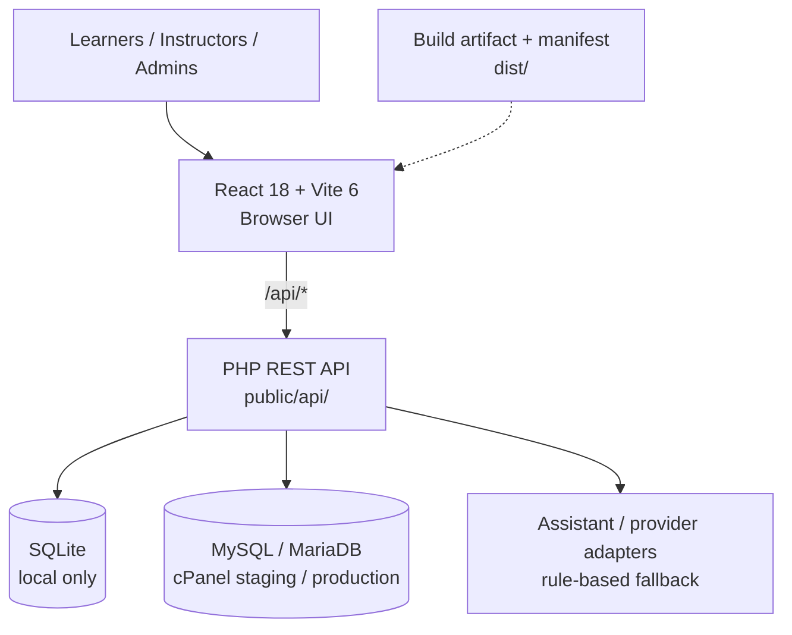

<div align="center">
  <picture>
    <source media="(prefers-color-scheme: dark)" srcset="docs/readme-assets/aapm-dark.svg"/>
    
  </picture>
  <h1>AAPM Layer Academy</h1>
  <p><strong>Learning, assessments, certificates and farm learning experience</strong></p>
  <p>Existing React/Vite application with PHP API; staging and production configuration described below</p>
  <p>
    
    
    
    
    <picture><source media="(prefers-color-scheme: dark)" srcset="docs/readme-assets/mysql-dark.svg"/></picture>
  </p>
</div>

| Teknologi | Stack |
|:---:|---|
|  | **React 18** |
|  | **Vite 6** |
|  | **PHP API** |
|  | **SQLite local** |
| <picture><source media="(prefers-color-scheme: dark)" srcset="docs/readme-assets/mysql-dark.svg"/></picture> | **MySQL on cPanel** |


---

<details>
<summary><strong>Detail teknis: stack, arsitektur, testing, dan deployment</strong></summary>

## Detailed technology stack — verified implementation

> **Versi:** `^` pada dependensi berarti rentang versi. Hosting staging dan production menggunakan PHP 8.4 menurut panduan deployment.

### Runtime, UI, APIs and data

<p>        <picture><source media="(prefers-color-scheme: dark)" srcset="docs/readme-assets/mysql-dark.svg"/></picture> </p>

| Layer | Technology | Version / role | Evidence |
|---|---|---|---|
|  **Frontend application** | React / React DOM | **^18.2.0**; interactive course and learner experience | [`package.json`](package.json) |
|  **Frontend development / bundle** | Vite + React plugin | Vite **^6.4.5**, plugin **^4.3.4** | Package manifest |
|  **Language / checking** | TypeScript toolchain | TypeScript **^5.8.2**; `tsc -p ./jsconfig.json` | Package manifest |
|  **Styling** | Tailwind CSS | **^3.4.17**, PostCSS/autoprefixer | Package manifest |
|  **UI primitives** | Radix UI, Lucide React, Iconify | Accessible overlay/control primitives; Lucide **^0.475.0** | Package manifest |
| <picture><source media="(prefers-color-scheme: dark)" srcset="docs/readme-assets/reactrouter-dark.svg"/></picture> **Client navigation** | React Router DOM | **^7.18.4** declared | Package manifest |
|  **Forms / validation** | React Hook Form, Zod, resolvers | RHF **^7.54.2**; Zod **^4.6.7** | Package manifest |
|  **Server-state** | TanStack React Query | **^5.84.1** | Package manifest |
| **Editorial / course authoring** | Tiptap editor | **^3.30.5** editor package family | Package manifest |
| **Presentation** | Recharts, Framer Motion, React Leaflet | Charts, motion, maps; feature usage must be checked in actual pages | Package manifest |
| **Document / content tools** | pptx viewer, jsPDF, pdfjs-dist, JSZip | View/import/export content; deployment bundle inclusion depends on app build | Package manifest |
| **Frontend payment SDK** | Stripe JS + React Stripe | Declared libraries, **not proof of production payment activation** | Package manifest |
|  **Server-side API** | Native PHP REST API | Source in `public/api/`; designed for PHP >=7.4; current cPanel site runtime documented as **PHP 8.4** | Existing README |
|  **Local persistence** | SQLite | `pdo_sqlite`; development-only local data | Existing README |
| <picture><source media="(prefers-color-scheme: dark)" srcset="docs/readme-assets/mysql-dark.svg"/></picture> **Hosted persistence** | MySQL / MariaDB | Private cPanel config; separate staging and production environment controls | Existing README |
|  **Server authentication** | PHP sessions + password_hash/password_verify | Secure session cookies, CSRF, policy and rate-limit guards | Existing README |
| **AI / assistance** | PHP API assistant endpoints with rule-based fallback | Provider registry and fallback; don't imply a cloud model is always online | Existing README |
|  **Release packaging** | Manifested `dist/` artifact | Channel-specific builds, fingerprint and PHP artifact checks | Scripts + existing README |

### Application topology (current repository pattern)



The database choices shown above are **environment alternatives**, not a claim that SQLite and MySQL both serve the same production request.

### Delivery and quality tooling

| Task | Command / mechanism | Contract |
|---|---|---|
| Frontend local | `npm run dev` | Vite proxies `/api` to local PHP server per existing README |
| Source lint | `npm run lint` | ESLint checks source |
| Types | `npm run typecheck` | Project TS configuration |
| Automated tests | `npm test` | Node tests for curriculum, assessment, certification, admin, mail, AI and UI flows |
| Design tokens | `npm run tokens` / `npm run tokens:check` | Generated token parity |
| Staging build | `npm run build:staging` | Manifested staging artifact |
| Production build | `npm run build:production` | Manifested production artifact |
| Bundle parity | `npm run verify:dist` / `npm run verify:artifact-php` | Detect stale or incomplete artifacts |
| PHP validation | `npm run lint:php` | PHP syntax checks via repository script |
| Hosting | cPanel Git Version Control | Existing README documents `develop` → staging, `main` → production |
| DB changes | Explicit environment-checked PHP migration commands | Database migration must be approved and independently verified |

### Critical business/security boundary

- Courses, lessons, quizzes, progress, certificates, verification, and role-scoped admin APIs are owned by this product; **do not replace them with Laravel routing from ERP modernization**.
- PHP session and CSRF checks are authoritative. Frontend visibility is not an authorization boundary.
- A server-side **environment marker** separates local SQLite, staging and production MySQL; mismatch must fail closed.
- `dist/` is an **immutable/reproducible release artifact** tied to branch/channel; protected uploads must survive releases.
- React/Radix/Tiptap/Stripe/AI dependencies describe source capability only; **activation and runtime success require integration evidence**.

**Canonical details:** [Current README deployment and API sections](#native-api) · [Application manifest](package.json) · `public/api/` · `scripts/release/`
</details>

---

Native local/cPanel version of the Layer Farm Academy application. The
existing React/Vite screens and UI structure are preserved; persistence and
authentication now run through a PHP API with SQLite locally and MySQL on
cPanel.

## Stack

- React 18 + Vite + Tailwind CSS
- PHP 7.4+ compatible REST API (`public/api/`)
- SQLite for local development; MySQL/MariaDB for cPanel
- PHP sessions and `password_hash`/`password_verify` for authentication
- CSRF protection, strict session cookies, password policy, and auth rate limits
- Local rule-based Farm Assistant fallback; no Base44 runtime dependency

PHP 8.4 is the configured cPanel runtime for both staging and production.
Keep the two domains on the same PHP version and run the staging smoke test
before changing the production runtime again.

## Local development

Prerequisites: Node.js/npm and PHP with `pdo_sqlite` enabled. The bundled
Windows PHP in this workspace has the SQLite DLLs available but disabled, so
the commands below enable them per process without changing the global PHP
installation.

```powershell
Copy-Item config.native.example.php config.php
php -d extension=php_sqlite3.dll -d extension=php_pdo_sqlite.dll database/seed.php
php -d extension=php_sqlite3.dll -d extension=php_pdo_sqlite.dll -d upload_max_filesize=300M -d post_max_size=310M -S 127.0.0.1:8000 -t public public/router.php
```

The upload limits above allow the editor's MP4/WebM video uploads (up to
300 MiB). Shared hosting must also allow these PHP limits and the request
size; a lower server limit takes precedence over the app's limit.

In a second terminal:

```powershell
npm install
npm run dev
```

Open the Vite URL printed in the terminal. Vite proxies `/api` to the local
PHP server. The seed creates a demo account:

- Email: `demo@aapmlayeracademy.id`
- Password: `aapmacademy@2026`

The local SQLite database is created under `storage/` and is ignored by git.

The local `config.php` must declare `'environment' => 'local'` (the example does). Local SQLite
is refused for any other environment, and a missing environment fails closed.

## Native API

The API exposes:

- `/api/auth/*` — login, register, logout, and password reset
- `/api/modules` and `/api/quiz` — course content and questions
- `/api/progress` — per-user progress and quiz scores
- `/api/certificates` — per-user certificates
- `/api/farm-data` — per-user KPI rows
- `/api/ai-assistant` — local assistant response
- `/api/admin/ai/rewrite-editorial` — admin-only APPI rewrite for structured module copy and text blocks (preview-first)
- `/api/admin/ai/module-companion` — native cPanel APPI companion for module copy, structure, review, and course ordering (preview-first)
- `/api/health` — deployment health check

All mutating authenticated requests use the session's CSRF token. PHP creates
the table structure automatically on first request; `database/schema.sql` is
provided for explicit MySQL setup. `database/seed.php` is reserved for a new
or deliberately refreshed content database, while `database/migrate.php`
handles additive changes on an existing learner database.

New accounts and password resets require at least 8 characters containing a
letter and a number. Login and reset attempts are throttled per IP/account,
and reset links are single-use with a 60-minute expiry. Configure `app_url`
and `mail_from` in the private cPanel config so forgot-password messages can
be delivered by the server's mail transport.

## Environments, artifacts, and deployment

Each environment is isolated. Production and staging never share a database,
private configuration file, or uploads directory, and neither can fall back to
the other or to SQLite.

| Environment | Database | Private config (outside public_html) | Uploads directory |
|---|---|---|---|
| `local` / `test` | SQLite, explicitly configured (disposable tests) | repository-root `config.php` (local only) | `public/uploads` (dev server) |
| `staging` | dedicated MySQL/MariaDB database and user | `/home/aapp8359/aapmlayeracademy-staging-config.php` | `public_html/staging.aapmlayeracademy.id/uploads` |
| `production` | dedicated MySQL/MariaDB database and user | `/home/aapp8359/aapmlayeracademy-production-config.php` | `public_html/uploads` |

### How configuration is chosen

- The private file must declare `environment` (`production`, `staging`, `local`,
  or `test`). A missing or unknown value is refused.
- A deployed target carries a generated selector, `api/deployment.php`, which
  names its environment and private file. It is written by the deploy script,
  is never part of the artifact, and answers direct web requests with 404.
- The request host never selects configuration. Setting the `Host` header to a
  production name on the staging site still reports `staging`.
- Deployed environments must use MySQL. SQLite is accepted only for `local` and
  `test`. Placeholder values (`REPLACE_…`) and an `app_url` that is not `https`
  are refused.
- Failures return HTTP 503 with a fixed code such as `config_missing`,
  `sqlite_not_allowed`, or `build_identity_mismatch`. Responses never include
  paths, DSNs, or credentials.
- A database carries an environment marker (`aapm_environment_marker`). The
  marker is checked before any schema statement, so a misdirected configuration
  cannot alter another environment's data.

### Provisioning a deployed environment (no secrets in this repository)

Run these in order for each environment. Take a database backup first if the
database already holds learner data.

1. Create a dedicated MySQL/MariaDB database and user in cPanel for that
   environment only. Do not reuse another environment's credentials.
2. Copy `config.staging.example.php` or `config.production.example.php` to the
   private path above, replace every `REPLACE_` value on the server, and restrict
   the file to the account user (`chmod 600`). Never commit it.
3. Provision the marker. This writes only the marker table and row:

   ```bash
   AAPLAYERACADEMY_CONFIG=/home/aapp8359/aapmlayeracademy-staging-config.php php database/migrate.php --init-environment-marker --expect-environment=staging
   ```

4. Apply the additive migration and verify it:

   ```bash
   AAPLAYERACADEMY_CONFIG=/home/aapp8359/aapmlayeracademy-staging-config.php php database/migrate.php --apply --verify --expect-environment=staging
   ```

   `--apply` and `--init-environment-marker` refuse to run without
   `--expect-environment`, and refuse if it does not match the private file.
   `--plan` and `--verify` are read-only.

5. Only if content references the tracked sample media, import it once. This is
   additive: existing files are never overwritten, and a differing file stops the
   import before anything is copied.

   ```bash
   php scripts/release/import-sample-media.php --source=public/uploads --target=<docroot>/uploads
   php scripts/release/import-sample-media.php --source=public/uploads --target=<docroot>/uploads --apply
   ```

**Production gate:** the current production file is
`/home/aapp8359/aapmlayeracademy-config.php`, which was shared with staging. Copy
it to the production-named path, verify it, and run the marker step before any
deploy of this change to `main`. Until then the deploy script refuses the
configuration and nothing is copied.

### Building an artifact

`dist/` is a deployment artifact generated from source. Build it from the branch
you intend to deploy, and commit it only after verification passes.

```bash
npm run build:staging      # develop → staging artifact
npm run build:production   # main → production artifact (build on main)
npm run verify:dist        # Node verifier against the checked source
npm run verify:artifact-php
```

Each build records a channel, the source commit, a source-tree fingerprint, an
artifact identifier, a build time, and the migration key in
`dist/build-manifest.json`. Runtime uploads are removed from the payload, and only
`uploads/.htaccess` ships. The verifiers reject an artifact when:

- a file differs from the manifest, or an undeclared file is present;
- the distributed API differs from `public/api`;
- the source changed since the build (`stale_artifact`);
- the channel does not match the target;
- a required asset is missing, or a forbidden deployment selector is present.

The fingerprint excludes `dist/` itself, so committing the artifact does not
invalidate it.

### Deploying (cPanel Git Version Control)

`.cpanel.yml` maps branches to channels. `main` deploys to production and
`develop` deploys to staging. The deploy script:

1. checks the private file for that channel and refuses placeholders, a wrong
   environment, a non-MySQL driver, or a location inside the target;
2. verifies the artifact against the checked source and rejects anything stale or
   tampered, copying nothing;
3. stages a copy outside the document root and verifies it;
4. installs file by file with atomic renames. It never writes, replaces, or deletes
   anything under `uploads/`, and creates `uploads/.htaccess` only if absent;
5. verifies the installed tree, confirms the uploads inventory is unchanged, and
   writes a receipt outside the document root.

A partial install reports `release incomplete`, not success.

Set `AAPM_PHP` in the cPanel environment if the account's default `php` is not the
PHP 8.4 CLI used by the domains.

If **Update from Remote** reports “up-to-date”, the checked branch has no newer
remote commit to pull; this does not confirm deployment. Read the latest
`~/.cpanel/logs/vc_*_git_deploy.log` when the deployment status is still pending.
`DEPLOY ABORTED: private config file not found` means that the branch's dedicated
private file is missing: `aapmlayeracademy-staging-config.php` for `develop`, or
`aapmlayeracademy-production-config.php` for `main`, under `/home/aapp8359/`.
Provision the matching example and dedicated database as described above before
deploying. The repository name does not select the environment; the checked
branch does. Do not reuse the legacy shared config to bypass this isolation.

### Rollback

Rollback redeploys the previous artifact with the same script: check out the
previous `dist/` commit, then run the deploy for that channel. Uploads are never
touched, and migrations are additive, so older code runs against the newer schema.
The fixture suite exercises this path (`rollback to a previous artifact restores it
and keeps uploads`).

### Verification status

Automated tests run in `npm test`. They start the real API under `php -S` against
disposable SQLite and fixture targets, and they never open a staging or production
database, host, or upload directory. Real staging activation (a provisioned
database, a private configuration, a verified migration, and smoke tests) needs
cPanel access and is recorded separately as `BLOCKED_BY_INFRASTRUCTURE` until it
is performed.

## Content migration

The repository contained the original Base44 entity schemas but not the
hosted module/quiz records. The native seed therefore provides 22 editable
demo modules and questions matching that schema. Replace the seed content or
load the final curriculum into `course_modules` and `quiz_questions` when it
is available.

## Google login

Google OAuth is implemented as an optional server-side adapter. It is shown in
the login/register screen only when the private config contains
`google_client_id`, `google_client_secret`, and `google_redirect_uri`. Register
the callback URL as:

`https://staging.aapmlayeracademy.id/api/auth/google/callback`

Never commit those values. Email/password remains available as the fallback.

## AI provider registry

Verified `admin` and `super_admin` accounts can use the Admin workspace.
Only `super_admin` can create accounts, change assigned roles, reset another
account's password, or start a new learning generation. Ordinary admins can
read the account list and manage Academy material. Role changes revoke the
target's existing sessions; an assigned Admin role is inactive until email
verification succeeds. Super Admin accounts are protected from these account
forms. They are provisioned explicitly by an authorized server operator:

```bash
php scripts/security/provision-admin.php --expect-environment=production --user-id=EXISTING_ID --role=super_admin --actor=AUTHORIZED_OPERATOR --evidence-ref=OWNER_APPROVAL_REFERENCE --dry-run
```

Run with the production private configuration selected and inspect the dry-run
before replacing `--dry-run` with `--apply`. Super Admin promotion requires an
existing verified Admin; names and configured email allowlists never grant it.

Admin → APPI settings supports a multi-provider registry instead of a single
hard-coded connection. The registry supports OpenRouter, OpenAI-compatible
gateways, Gemini, Anthropic, Ollama, LM Studio, LocalAI, vLLM, and custom
OpenAI-compatible endpoints. Each connection can have its own model, base URL,
authentication mode, custom headers, streaming/vision capability, endpoint
paths, token limit, temperature, and timeout. The model discovery action reads
`/models` when the provider exposes it; native Anthropic connections require a
manually entered model ID.

Provider API keys and custom headers are encrypted with AES-256-GCM in the
existing `app_settings` table. Set `ai_settings_encryption_key` in the private
cPanel config before saving credentials from Admin. Existing single-provider
settings are migrated lazily into the registry and the legacy scalar settings
are kept in sync during the rolling deploy.

Learners can open Profile → Preferensi APPI and choose the global AAPM
provider, another provider made available by Admin, or a private BYOK/local
OpenAI-compatible endpoint. Account overrides and their credential are isolated
to that account; the global provider remains the safe default and fallback.
Google OAuth is already available for account login when configured. AI OAuth is
not universal across providers: it must be implemented as a provider-specific
authorization flow when that provider exposes OAuth, while API-key/BYOK support
works with the generic contract above.

For local AI, remember that the request originates from the PHP/cPanel server,
not from the administrator's laptop. Use `localhost` only when the model runs
on the same server; use an HTTPS endpoint or explicitly enabled private-network
endpoint when the model runs on another machine. Public HTTP endpoints remain
blocked to reduce SSRF risk.

<details>
<summary>Logo attribution</summary>

<sub>SVG artwork: AAPM internal brand assets and [Devicon (MIT)](https://github.com/devicons/devicon/blob/master/LICENSE). Trademarks belong to their respective owners.</sub>

</details>
